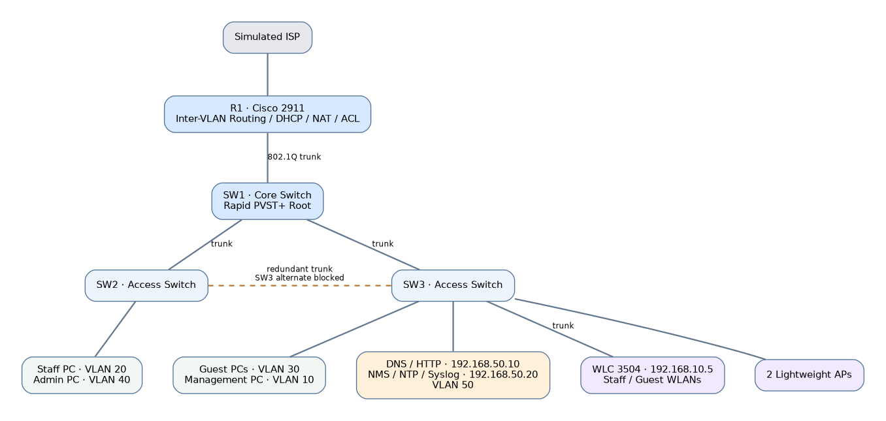
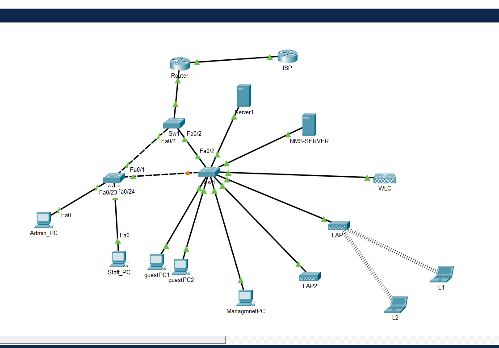
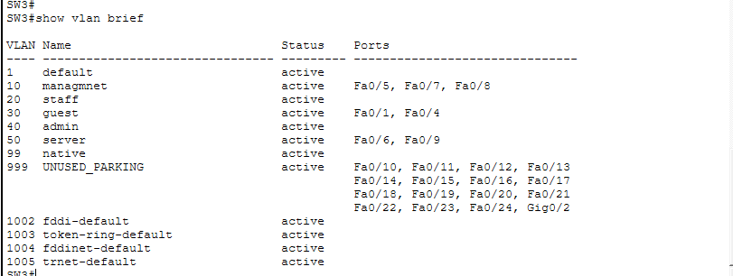
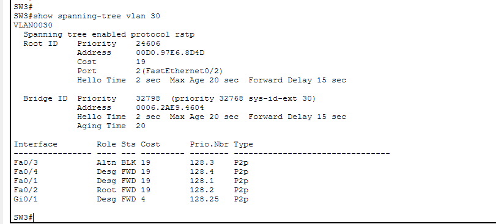
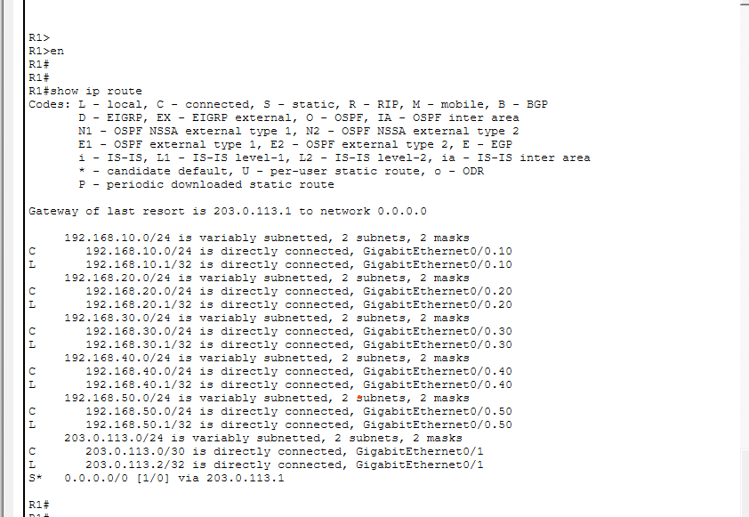
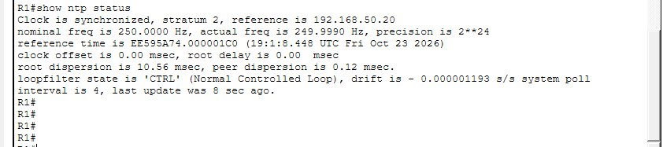

# 🏨 Green Valley Hotel 2.0 — Enterprise Network Design & Implementation

### Cisco Packet Tracer | CCNA 200-301 | Enterprise LAN | Network Security | Wireless Networking

**Project Status:** Completed  
**Simulation Platform:** Cisco Packet Tracer  
**Project Category:** Enterprise Network Design, Configuration, Verification & Troubleshooting

---

## 📌 1. Project Overview

Green Valley Hotel 2.0 is a simulated enterprise network designed to provide secure, reliable, and scalable connectivity for a hotel environment.

The project demonstrates the practical implementation of Cisco networking technologies, including VLAN segmentation, inter-VLAN routing, Rapid PVST+, DHCP, NAT/PAT, access control lists, wireless LAN management, Layer 2 security, and network monitoring.

The network separates hotel departments into dedicated VLANs while providing controlled communication between authorized users, centralized network services, and simulated internet connectivity.

This project was developed as a hands-on application of the **Cisco CCNA 200-301 curriculum**, with emphasis on network configuration, security, troubleshooting, and verification.

## 🎯 2. Project Objectives

- Design and implement a multi-VLAN enterprise LAN.
- Separate management, staff, guest, administration, and server traffic.
- Configure IEEE 802.1Q trunking between network devices.
- Implement inter-VLAN routing using router-on-a-stick.
- Configure DHCP for automatic IPv4 address allocation.
- Implement NAT/PAT for simulated external network access.
- Restrict unauthorized guest access using extended ACLs.
- Configure Rapid PVST+ for Layer 2 loop prevention and redundancy.
- Secure access ports using port security, DHCP snooping, Dynamic ARP Inspection, PortFast, and BPDU Guard.
- Deploy centrally managed wireless networks using a Cisco Wireless LAN Controller.
- Configure Syslog, SNMP, and NTP for network monitoring and management.
- Perform end-to-end verification and troubleshooting.

---

## 🏗️ 3. Network Architecture

The enterprise network follows a hierarchical design with centralized routing, a core switch, redundant access-switch connections, and dedicated services.

### Network Infrastructure

| Device | Model | Function |
|---|---|---|
| R1 | Cisco 2911 | Inter-VLAN routing, DHCP, NAT/PAT, ACLs |
| SW1 | Cisco 2960 | Core switch and STP root bridge |
| SW2 | Cisco 2960 | Access switch for Staff and Administration |
| SW3 | Cisco 2960 | Access switch for Guest, Management, Servers, and WLAN infrastructure |
| WLC | Cisco 3504 | Centralized wireless LAN management |
| AP1 and AP2 | Lightweight APs | Wireless connectivity |
| DNS/HTTP Server | Server-PT | Internal DNS and web services |
| NMS Server | Server-PT | Syslog and NTP services |
| ISP | Simulated network | External connectivity |

### Logical Network Topology

The following diagram illustrates the logical architecture of the
Green Valley Hotel 2.0 Enterprise Network.



The SW1–SW2–SW3 triangle provides redundant Layer 2 connectivity. Rapid PVST+ prevents switching loops by placing a redundant port into a non-forwarding state.

## 🏗️ Network Topology

The following diagram shows the complete Green Valley Hotel 2.0
enterprise network implemented in Cisco Packet Tracer.



---

## 🌐 4. VLAN and IP Addressing Design

| VLAN | VLAN Name | Network | Default Gateway | Purpose |
|---|---|---|---|---|
| 10 | Management | 192.168.10.0/24 | 192.168.10.1 | Network device management |
| 20 | Staff | 192.168.20.0/24 | 192.168.20.1 | Hotel staff |
| 30 | Guest | 192.168.30.0/24 | 192.168.30.1 | Guest wired and wireless access |
| 40 | Administration | 192.168.40.0/24 | 192.168.40.1 | Administrative users |
| 50 | Servers | 192.168.50.0/24 | 192.168.50.1 | DNS, HTTP, and monitoring |
| 99 | Native | N/A | N/A | 802.1Q native VLAN on switch trunks |
| 999 | Parking | N/A | N/A | Unused access ports |

### Infrastructure IP Addresses

| Device | IP Address |
|---|---|
| R1 Management Gateway | 192.168.10.1 |
| SW1 Management | 192.168.10.2 |
| SW2 Management | 192.168.10.3 |
| SW3 Management | 192.168.10.4 |
| Wireless LAN Controller | 192.168.10.5 |
| DNS/HTTP Server | 192.168.50.10 |
| Network Monitoring Server | 192.168.50.20 |

---

## ⚙️ 5. Technologies Implemented

### 5.1 VLANs and Trunking

Configured VLANs on Cisco switches to separate departmental traffic into distinct broadcast domains.

IEEE 802.1Q trunk links carry multiple VLANs between the core switch, access switches, and router.

**Verification commands:**

```bash
show vlan brief
show interfaces trunk
show interfaces switchport
```

### 5.2 Inter-VLAN Routing

Implemented router-on-a-stick on R1 using GigabitEthernet0/0 subinterfaces.

Each subinterface is configured with IEEE 802.1Q encapsulation and serves as the default gateway for its VLAN.

**Example configuration:**

```bash
interface gigabitEthernet0/0.20
 encapsulation dot1Q 20
 ip address 192.168.20.1 255.255.255.0
```

**Verification commands:**

```bash
show ip interface brief
show ip route connected
```

### 5.3 Dynamic Host Configuration Protocol (DHCP)

Configured R1 as a centralized DHCP server for the five operational VLANs.

Each DHCP pool provides the appropriate network, default gateway, and DNS settings.

The addresses from `.1` through `.20` are excluded from dynamic allocation in each VLAN.

**Verification commands:**

```bash
show ip dhcp pool
show ip dhcp binding
show running-config | section dhcp
```

### 5.4 Network Address Translation (NAT/PAT)

Configured Port Address Translation to allow multiple internal VLANs to share the router's external interface address.

**Verification commands:**

```bash
show ip nat translations
show ip nat statistics
```

### 5.5 Access Control Lists (ACLs)

Implemented an extended ACL named `guest_isolation` on R1.

The policy prevents Guest VLAN 30 from accessing protected internal VLANs while permitting DHCP and other authorized traffic, including simulated external connectivity.

**Verification commands:**

```bash
show access-lists
show ip interface gigabitEthernet0/0.30
```

### 5.6 Rapid Spanning Tree Protocol

Configured Rapid PVST+ across SW1, SW2, and SW3.

SW1 operates as the root bridge for the configured VLANs.

The redundant SW2–SW3 connection provides an alternate Layer 2 path while STP prevents switching loops.

**Verification commands:**

```bash
show spanning-tree
show spanning-tree vlan 30
```

### 5.7 Layer 2 Network Security

Implemented multiple security mechanisms:

- **Port Security:** Sticky MAC address learning and violation restrictions.
- **DHCP Snooping:** Protection against unauthorized DHCP server responses.
- **Dynamic ARP Inspection:** ARP validation for Guest VLAN 30.
- **PortFast:** Faster forwarding transitions on appropriate access ports.
- **BPDU Guard:** Protection against unexpected BPDUs on edge ports.
- **Parking VLAN:** Isolation of unused switch ports.

**Verification commands:**

```bash
show port-security
show ip dhcp snooping
show ip arp inspection
show spanning-tree summary
```

### 5.8 Wireless LAN Implementation

Deployed a Cisco 3504 Wireless LAN Controller and two lightweight access points.

Configured separate wireless networks for hotel Staff and Guests, mapped to VLAN 20 and VLAN 30 respectively.

Wireless clients were tested for connectivity and appropriate VLAN assignment.

### 5.9 Network Monitoring and Management

Configured network management services to support monitoring, logging, and synchronized device clocks.

**Syslog**

Configured network devices to forward system messages to the NMS Server at `192.168.50.20`.

**SNMP**

Configured SNMPv2c read-only access for R1, SW1, SW2, and SW3. SNMP manager polling was not separately demonstrated.

**NTP**

Configured centralized network time synchronization using the NMS Server.

The synchronized hierarchy was verified as:

| Device | NTP Source | Stratum |
|---|---|---|
| NMS Server | Local NTP reference | 1 |
| R1 | 192.168.50.20 | 2 |
| SW1 | 192.168.10.1 | 3 |
| SW2 | 192.168.10.1 | 3 |
| SW3 | 192.168.10.1 | 3 |

**Verification commands:**

```bash
show ntp status
show ntp associations
show logging
```

---

## 🧪 6. Network Testing and Verification

The project included functional verification of the major network components.

| Test | Verification | Result |
|---|---|---|
| VLAN Configuration | VLAN membership and access ports | Passed |
| 802.1Q Trunking | Trunk links and allowed VLANs | Passed |
| Rapid PVST+ | Root bridge and alternate blocking path | Passed |
| Inter-VLAN Routing | Gateway reachability and authorized routing | Passed |
| DHCP | Dynamic IP assignment and lease bindings | Passed |
| NAT/PAT | Internal-to-external translation | Passed |
| Guest Isolation | ACL restrictions between VLANs | Passed |
| Layer 2 Security | Security configuration and operation | Passed |
| Wireless Networking | Staff and Guest WLAN connectivity | Passed |
| Syslog | Centralized log reception | Passed |
| NTP | Synchronized router and switch clocks | Passed |

The network was verified using Cisco IOS show commands, endpoint connectivity tests, and Packet Tracer simulation tools.

---

## 🔧 7. Troubleshooting Experience

Troubleshooting activities focused on identifying faults systematically using Cisco IOS diagnostic commands.

Key areas included:

- Incorrect access VLAN assignments.
- Trunk configuration and allowed VLAN mismatches.
- Spanning Tree port states and redundant links.
- DHCP address assignment and client connectivity.
- Guest ACL restrictions.
- NAT/PAT translation verification.
- Wireless client connectivity.
- Network time synchronization.

A structured troubleshooting approach was used:

**Identify the symptom → Verify Layer 1 and Layer 2 → Check Layer 3 connectivity → Inspect configuration → Correct the fault → Retest.**

---

## 📂 8. Repository Structure

```text
green-valley-hotel-enterprise-network/
│
├── README.md
├── Green-Valley-Hotel-2.0.pkt
│
├── docs/
│   └── Project-Documentation.pdf
│
├── configs/
│   ├── R1.txt
│   ├── SW1.txt
│   ├── SW2.txt
│   └── SW3.txt
│
└── screenshots/
    ├── topology.png
    ├── vlan-verification.png
    ├── stp-verification.png
    └── ntp-verification.png
```

## Network Verification Evidence

### VLAN Configuration


### Rapid PVST+ Verification


### Routing Verification


### NTP Synchronization



## 📚 9. Skills Demonstrated

**Network Design:** VLAN planning, IPv4 addressing, network segmentation, redundant switch topology.

**Routing and Switching:** Router-on-a-stick, IEEE 802.1Q, Rapid PVST+, inter-VLAN connectivity.

**Network Services:** DHCP, DNS, NAT/PAT, Syslog, SNMP, NTP.

**Network Security:** Extended ACLs, port security, DHCP snooping, DAI, BPDU Guard.

**Wireless Networking:** Wireless LAN Controller, lightweight APs, SSID-to-VLAN mapping.

**Troubleshooting:** Cisco IOS verification commands, connectivity testing, fault isolation, and configuration validation.

---

## 🚀 10. Future Enhancements

The next enterprise network project will expand on this foundation with:

- Multi-site enterprise topology.
- Dynamic routing using OSPF.
- Advanced route selection and redundancy.
- IPv6 addressing and routing.
- EtherChannel and additional switching redundancy.
- More advanced network security.
- Network automation using Python.
- REST APIs, JSON, and controller-based networking.
- Automated configuration backup and validation.

---

## 🏁 11. Conclusion

Green Valley Hotel 2.0 demonstrates the implementation of an enterprise-style LAN using Cisco networking technologies.

The project strengthened practical skills in network planning, routing and switching, wireless deployment, network security, centralized services, monitoring, and troubleshooting.

It also establishes a foundation for future projects involving dynamic routing, multi-site connectivity, and programmable networks.

**Tools:** Cisco Packet Tracer, Cisco IOS CLI  
**Focus:** CCNA 200-301, Enterprise Networking, Network Security, Troubleshooting


